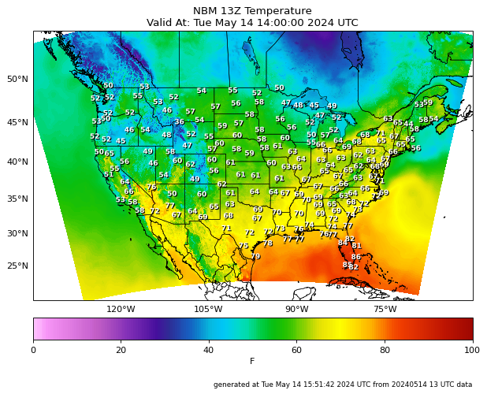
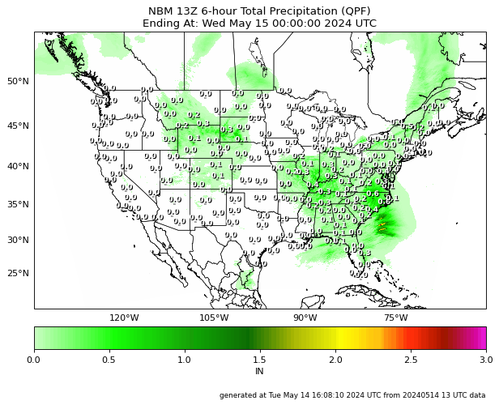

  

    

<a href="weather.gov">National Oceanic and Atmospheric Administration</a>

  

  

    Office of Modeling and Development: Weather Guidance & Products 
    
     
    <dl>
  
	As a data scientist at Arch Systems, I work with a team in the National Weather Service's (NWS) Office and Modeling and Development to develop next-generation statistical modeling software to assist in forecasting guidance. As part of the Weather Guidance and Products Division, our goal is to not only improve forecasting and post-processing methods scientifically but to empower users by building software tools that are accessible and flexible by leveraging open-source packages. 

</dl>

    
  

<h1>National Blend of Models</h1>

  

<a href="https://blend.mdl.nws.noaa.gov/nbm-images">National Blend of Models Quick-look</a>

 
Our primary focus is the National Blend of Models (NBM), a suite of forecast products based on a blend of both NWS and non-NWS numerical weather models, robustly calibrated to provide accurate and consistent forecasting guidance. A critical aspect of the NBM is the post-processing pipeline, in which the blended and calibrated numerical weather models are processed and statistically validated to create useful forecasting guidance products like precipitation accumulations, daily temperatures, and severe weather predictors on a consistent nationwide grid, covering the continental US, Alaska, Hawaii, and Puerto Rico. We recently implemented the <a href="https://vlab.noaa.gov/documents/6609493/7858320/NBM_v5_1_RRFS_REFS_Changes.pdf"> version 5.1 NBM</a> which added the new RRFS/REFS CAMs system as inputs to replace the HREF ensemble. Further improvements are underway for NBM v5.2 to update the weighting scheme for the QPF06 deterministic product and to include CAMs DMOs in the Days 1-2 grids to address the dry bias frequently introduced by quantile mapping. NBM v5.2 is slated for implementation late Q4. 

 
 
As part of the WGPD team, I am involved with the development, testing, and implementation of statistical pipelines to improve the reliability of precipitation forecasts. These include the treatment of ensemble forecasts and developing ways to improve the statistical calibrations to decrease forecast biases and errors. I have led major development of machine learning models to more accurately <a href="https://ams.confex.com/ams/2026Summit/meetingapp.cgi/Paper/481594"> predict hourly precipitation amounts from 6-hour totals</a> and am currently piloting the unified precipitation analysis project to enable more robust post-processing techniques across all NBM domains. 

